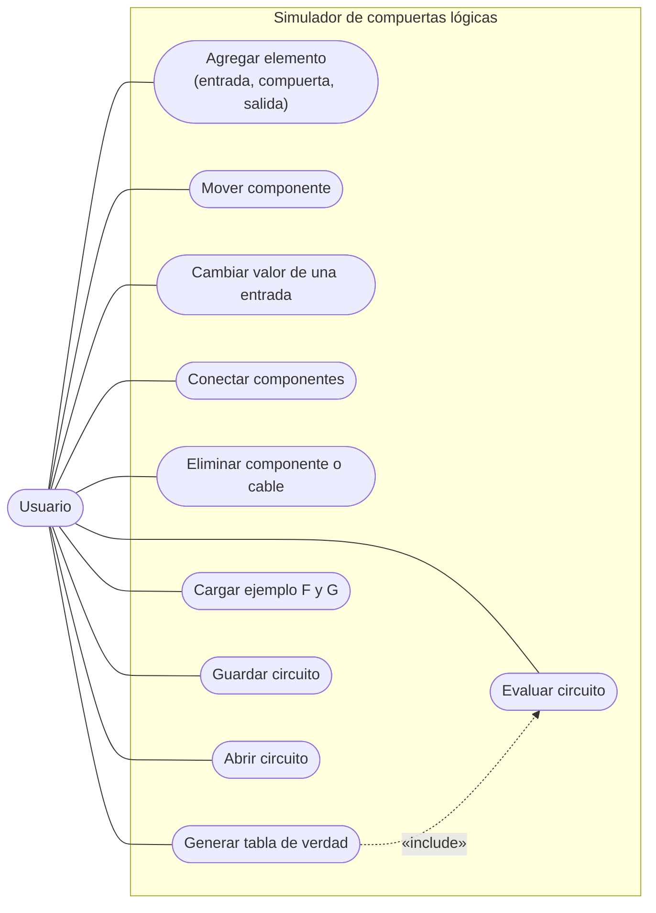

# Casos de uso — Simulador de compuertas lógicas

## Diagrama

> Los nombres siguen la convención verbo + objeto vista en clase.

## Especificación: Conectar componentes

| Campo | Descripción |
|---|---|
| **Actor** | Usuario |
| **Precondición** | Hay al menos dos componentes en el lienzo, uno con un punto de salida y otro con un punto de entrada libre u ocupado. |
| **Flujo principal** | 1. El usuario presiona sobre un punto de conexión y arrastra. 2. El sistema muestra un cable provisional que sigue al mouse. 3. El usuario suelta sobre un punto del tipo contrario. 4. El controlador pide al modelo realizar la conexión. 5. El modelo la acepta y la vista dibuja el cable. |
| **Flujo alterno A** | En el paso 3 se suelta en un lugar vacío: no ocurre nada. |
| **Flujo alterno B** | En el paso 3 el punto de entrada ya tenía un cable: el nuevo lo reemplaza. |
| **Excepción** | En el paso 4 la conexión crearía un ciclo, une dos puntos del mismo tipo, o la fuente no pertenece al circuito: el modelo lanza `ConexionInvalidaException`, el controlador muestra el mensaje y no se dibuja ningún cable. |
| **Postcondición** | El modelo y la vista quedan consistentes (cada cable visible corresponde a una conexión del modelo). |

## Especificación: Evaluar circuito

| Campo | Descripción |
|---|---|
| **Actor** | Usuario |
| **Precondición** | Existe al menos una salida. |
| **Flujo principal** | 1. El usuario pulsa «Evaluar». 2. El controlador pide al circuito evaluar sus salidas. 3. Cada salida pide su valor a la fuente conectada, y las compuertas se evalúan polimórficamente hacia atrás hasta las entradas. 4. El sistema muestra `F = 1   G = 0` en la barra de estado. |
| **Flujo alterno** | Si no hay salidas, el sistema lo indica en la barra de estado. |
| **Excepción** | Alguna compuerta o salida tiene una entrada sin conectar: se lanza `EntradaSinConectarException` y se informa cuál es. |
| **Postcondición** | Los puntos indicadores de todo el circuito muestran los valores actuales (vacío = 0, relleno = 1). |

## Especificación: Guardar circuito

| Campo | Descripción |
|---|---|
| **Actor** | Usuario |
| **Precondición** | Ninguna: un circuito vacío también puede guardarse. |
| **Flujo principal** | 1. El usuario pulsa «Guardar…». 2. El sistema muestra el selector de archivos. 3. El usuario elige o escribe un nombre (si no tiene extensión, se agrega `.txt`). 4. El controlador reúne las posiciones (x, y) de los componentes dibujados. 5. El repositorio escribe el circuito en un archivo de texto UTF-8 (ver `FormatoArchivo.md`). 6. La barra de estado indica «Circuito guardado en …». |
| **Flujo alterno A** | En el paso 3 el usuario cancela: no ocurre nada. |
| **Flujo alterno B** | En el paso 3 el archivo ya existe: el sistema pide confirmar el reemplazo; si el usuario no confirma, el archivo no cambia. |
| **Excepción A** | El archivo no puede escribirse (`IOException`: sin permisos, ruta inválida, disco lleno): se informa «No tiene permisos…» o «No fue posible guardar el archivo…». |
| **Excepción B** | Un nombre del circuito no puede representarse en el formato (contiene `;`, es `-` o está repetido): el repositorio lanza `CircuitoException` **antes** de abrir el archivo, y se muestra su mensaje. |
| **Postcondición** | Si algo falla, el archivo anterior no se daña. Guardar nunca modifica el circuito en pantalla. |

## Especificación: Abrir circuito

| Campo | Descripción |
|---|---|
| **Actor** | Usuario |
| **Precondición** | Ninguna. |
| **Flujo principal** | 1. El usuario pulsa «Abrir…». 2. El sistema muestra el selector de archivos y el usuario elige uno. 3. El repositorio lee el archivo línea a línea, valida su contenido y construye un circuito **nuevo**. 4. Si hay un circuito dibujado, el sistema pide confirmar el reemplazo. 5. La vista construye los componentes y cables del circuito cargado (con las posiciones guardadas; si faltan, los acomoda en columnas). 6. El sistema reemplaza el circuito y el lienzo, y la barra de estado indica «Circuito abierto desde …». |
| **Flujo alterno A** | En el paso 2 el usuario cancela: no ocurre nada. |
| **Flujo alterno B** | En el paso 4 el usuario no confirma: el circuito actual se conserva. |
| **Excepción A** | El archivo no existe (`NoSuchFileException`) o no hay permisos (`AccessDeniedException`) u otra falla de lectura (`IOException`): se informa con un mensaje distinto para cada caso. |
| **Excepción B** | El contenido no es un circuito válido (cabecera o versión incorrecta, compuerta desconocida, referencia inexistente, nombre repetido, ciclo, archivo vacío o dañado): el repositorio lanza `FormatoCircuitoException` con el **número de línea** y el motivo. |
| **Postcondición** | Ante cualquier error el circuito actual y el lienzo **no se modifican**. Solo se reemplazan si el archivo fue leído y validado por completo. |
