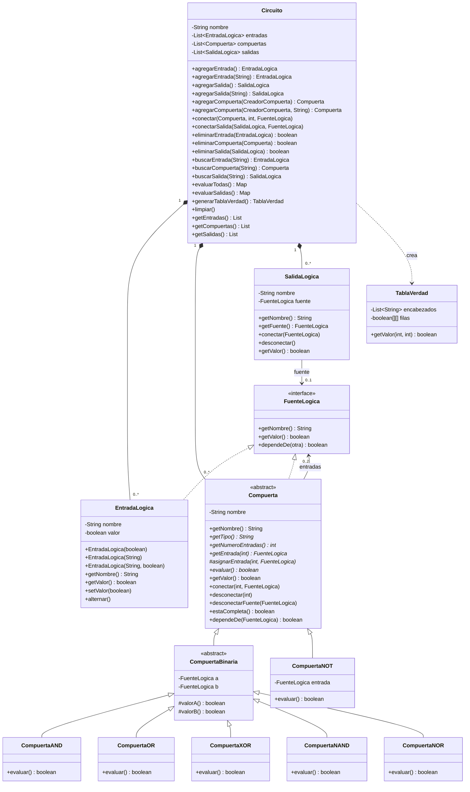
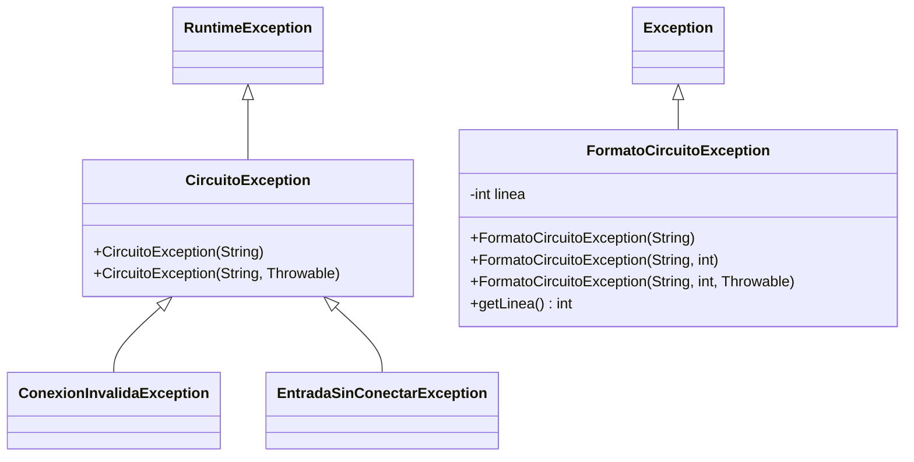
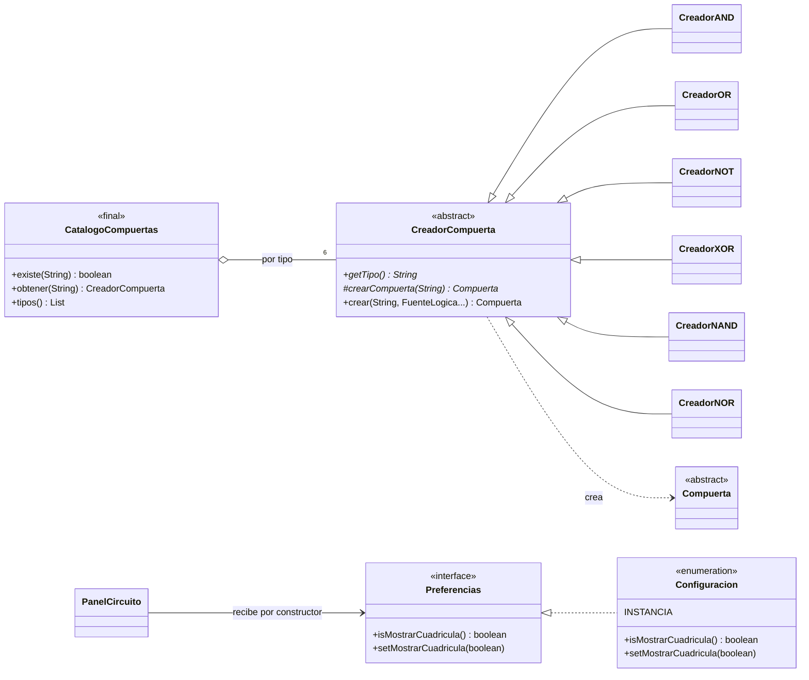
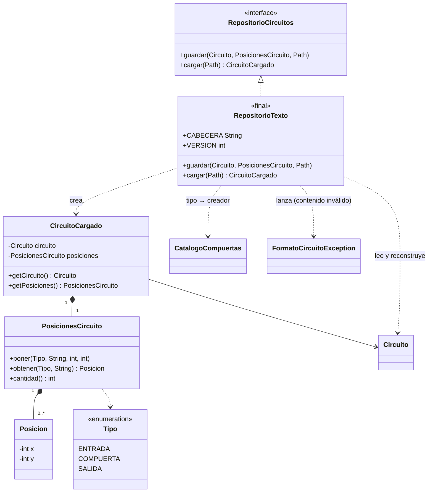
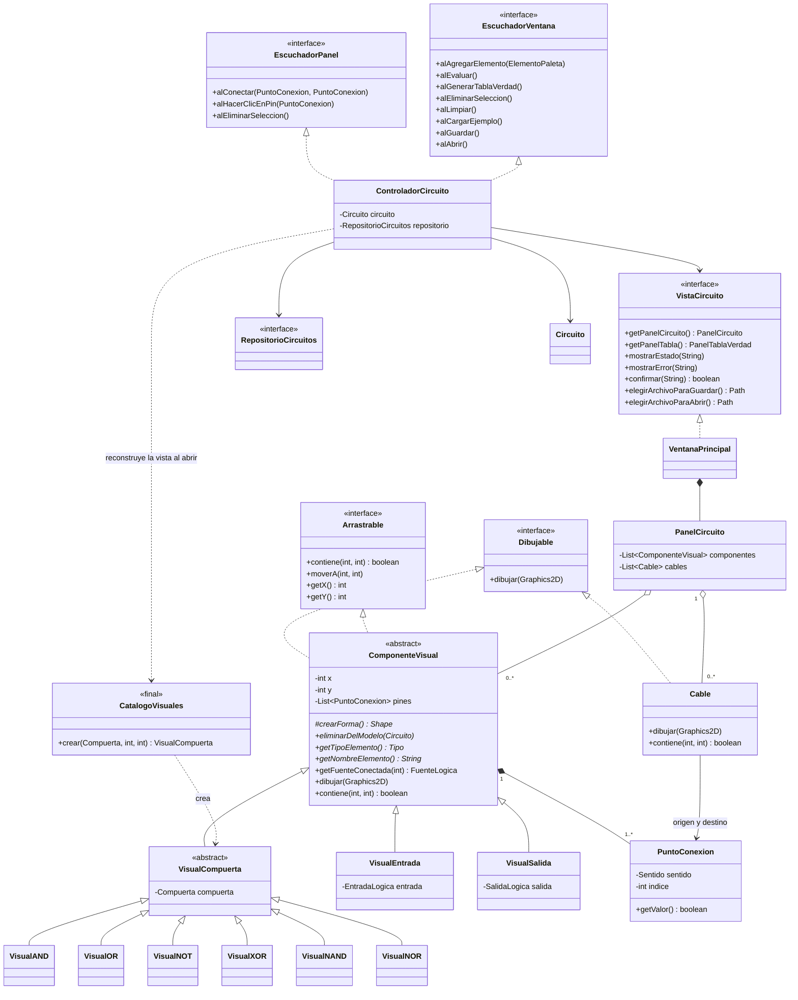

# Diagramas de clases (UML)

Visibilidad: `+` público, `-` privado, `#` protegido. Triángulo hueco = herencia o implementación,
rombo negro = composición, rombo hueco = agregación, flecha simple = asociación, flecha punteada =
dependencia. Un `*` junto al nombre de un método indica que es abstracto.

El diagrama se divide en cinco partes para que cada una se pueda leer completa:
1. Modelo · 2. Excepciones · 3. Fábrica, catálogo y configuración · 4. Persistencia en texto ·
5. Vista y controlador.

## 1. Modelo

## 2. Excepciones

| Excepción | Tipo | Cuándo se lanza |
|---|---|---|
| `CircuitoException` | **no verificada** | Base: uso incorrecto del modelo (nombre duplicado, tabla sin entradas...). |
| `ConexionInvalidaException` | no verificada | Ciclo, autoconexión, entrada inexistente, fuente ajena al circuito. |
| `EntradaSinConectarException` | no verificada | Se evalúa algo con una entrada sin conectar. |
| `FormatoCircuitoException` | **verificada** | El archivo se abrió pero su contenido no es un circuito válido (indica la línea). |

Las fallas de acceso al archivo (no existe, sin permisos) **no** tienen clase propia: se propagan como
`java.io.IOException`, para no confundir «no se pudo leer» con «lo que se leyó es inválido».

## 3. Fábrica (Factory Method), catálogo y configuración (Singleton)

## 4. Persistencia en texto

El **modelo no conoce los archivos**: `Circuito` no depende de este paquete. La posición `(x, y)` pertenece a la
vista, por eso viaja en `PosicionesCircuito` (que no depende de Swing). Formato del archivo: ver `FormatoArchivo.md`.

## 5. Vista y controlador

