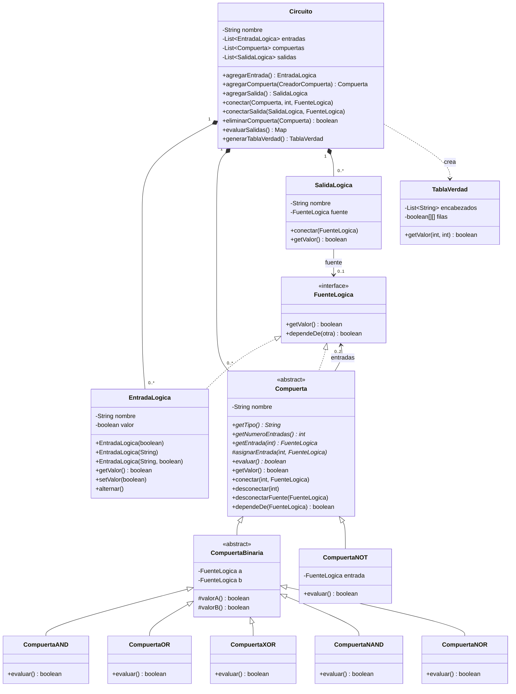
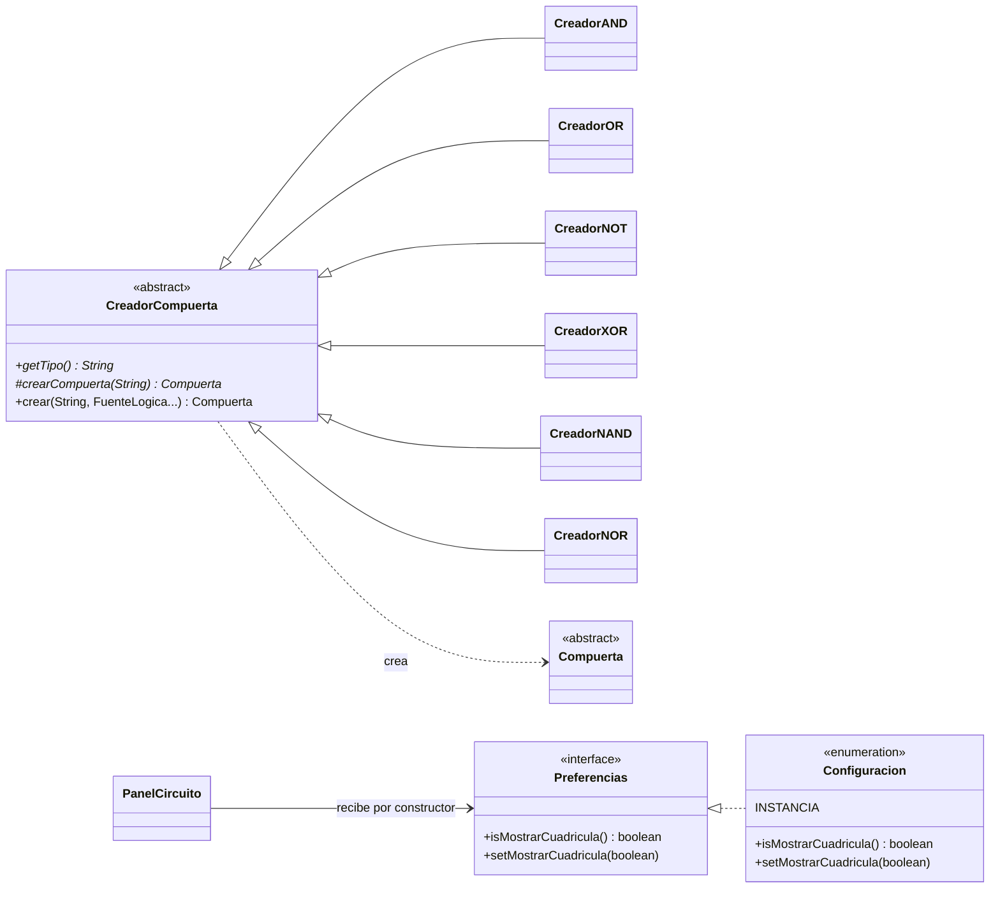
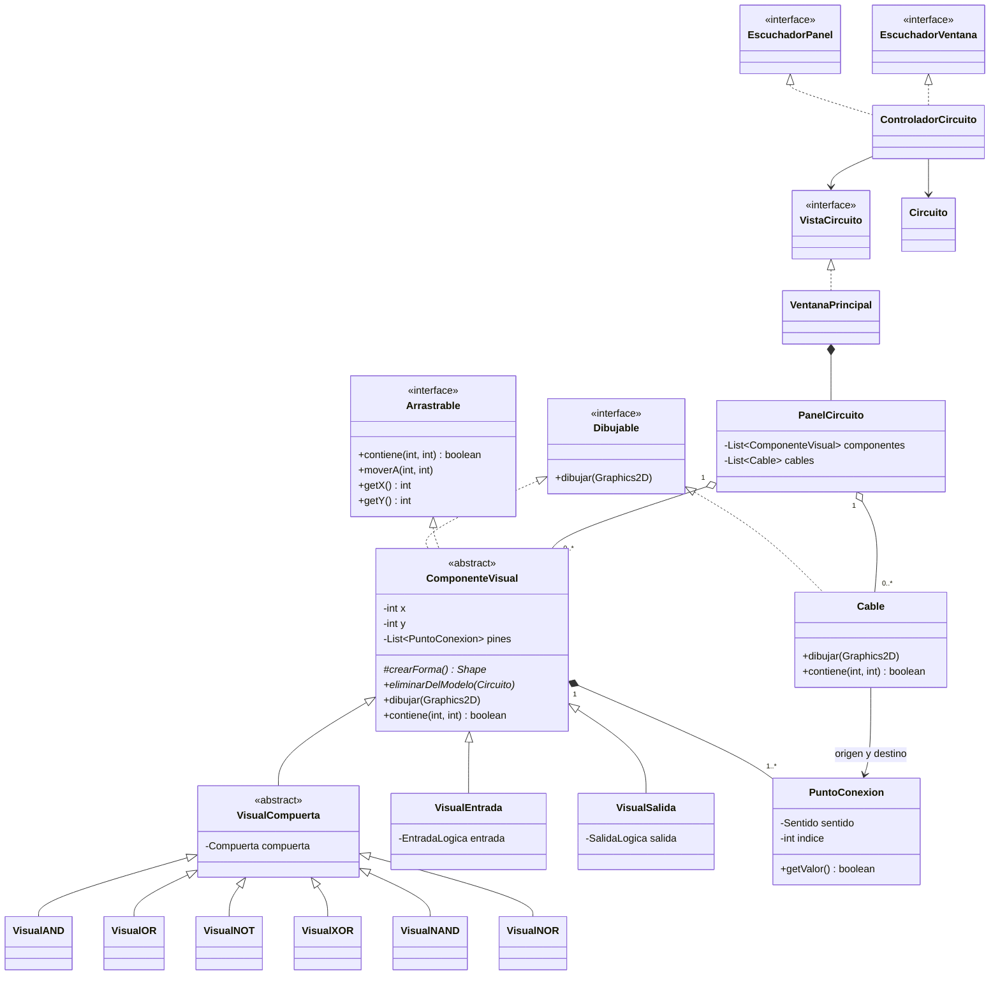

# Diagramas de clases (UML)

Visibilidad: `+` público, `-` privado, `#` protegido. Triángulo hueco = herencia o implementación,
rombo negro = composición, flecha simple = asociación.

## 1. Modelo

## 2. Fábrica (Factory Method) y configuración (Singleton)

## 3. Vista y controlador

