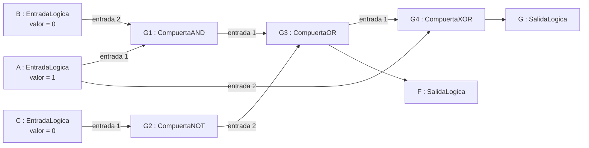

# Diagrama de objetos — F = (A AND B) OR NOT(C) y G = XOR(F, A)

Es la red de objetos que construye el botón **«Cargar ejemplo F y G»** (y la prueba de consola).
Cada flecha es una referencia: la compuerta guarda la fuente que alimenta cada una de sus entradas.

Con A=1, B=0, C=0: G1 = 0, G2 = 1, **G3 = F = 1**, **G4 = G = 0**.

## Tabla de verdad (la que genera el simulador)

| A | B | C | F | G |
|---|---|---|---|---|
| 0 | 0 | 0 | 1 | 1 |
| 0 | 0 | 1 | 0 | 0 |
| 0 | 1 | 0 | 1 | 1 |
| 0 | 1 | 1 | 0 | 0 |
| 1 | 0 | 0 | 1 | 0 |
| 1 | 0 | 1 | 0 | 1 |
| 1 | 1 | 0 | 1 | 0 |
| 1 | 1 | 1 | 1 | 0 |
